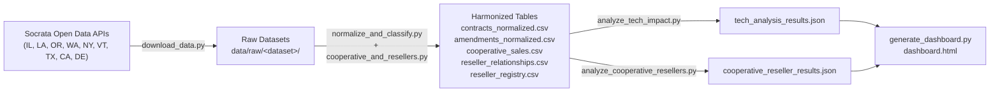

# change_order: Public Contract Amendments & Change Order Analysis

An empirical research toolkit and reproducible data pipeline for analyzing how public procurement contracts change over time—examining amendment frequencies, cost escalation, department concentration, vendor patterns, and the difference between **Technology** and **Non-Technology** contracts across programmatic domains.

---

## 1. Target Data & Jurisdictions

The project targets contract ledgers that capture amendment histories and change orders rather than procurement portals that only list open solicitations:

### A. Contract Ledgers with Amendment Histories (12 jurisdictions in 8 states: state, county, city and authority ledgers)

| Jurisdiction | Level | Dataset | Raw Records | Coverage & Amendment Tracking |
| :--- | :--- | :--- | :--- | :--- |
| **Chicago, IL** | City | [Contracts](https://data.cityofchicago.org/d/rsxa-ify5) | 186,213 | Contract revisions, revised award amounts, de-obligations, and departments. |
| **Baton Rouge, LA** | City-Parish | [Purchase Orders & Contracts](https://data.brla.gov/d/2ung-w7t4) | 345,509 | Municipal & parish purchase orders, adjustments, DBE / minority / veteran flags. |
| **Oregon** | State | [Historical ORPIN Contracts](https://data.oregon.gov/d/6e9e-sfc4) | 93,846 | Amendment sequences, original awards, amendment deltas, and total amended values. |
| **Washington State** | State | Agency Contracts FY[2021](https://data.wa.gov/d/buf8-6px9) · [2022](https://data.wa.gov/d/pwse-3zea) · [2023](https://data.wa.gov/d/mz6y-pfem) · [2024](https://data.wa.gov/d/s8d5-pj78) · [2025](https://data.wa.gov/d/6fx9-ncas) | 379,753 | Amendment identifiers, cost modifications, procurement type (incl. *Statewide Contract*), minority/women-owned, small business, and veteran certification. |
| **Cook County, IL** | County | [Awarded Contracts & Amendments](https://datacatalog.cookcountyil.gov/d/qh8j-6k63) | 8,342 | Extensions, renewals, dollar increases, scope changes. |
| **Oregon Lottery** | State | [Lottery Contracts](https://data.oregon.gov/d/rkhh-35im) | 24,279 | Purchase orders, line-item amendments, and vendor service agreements. |
| **Oregon Judicial Dept.** | State | [Judicial Dept. Contracts](https://data.oregon.gov/d/3wxk-gaen) | 2,829 | Fiscal-year snapshots with original value, running total value, and amendment counts. |
| **Oregon State Treasury** | State | [Treasury Contracts](https://data.oregon.gov/d/4iz8-xm93) | 5,136 | Not-to-exceed amounts with supplemental (amendment) amounts and dates. |
| **New York City** | Authority | [NYC SCA Change Orders](https://data.cityofnewyork.us/d/gzvm-na49) | 11,266 | School construction change orders, workflow stages, and contractor tracking. |
| **Vermont** | State | [Executed Contracts for Service](https://data.vermont.gov/d/dz5q-8uqb) | 6,614 | State agency service contracts, maximum limits, and vendor execution. |
| **West Hollywood, CA** | City | [Active Contracts](https://data.weho.org/d/atdr-sk64) | 1,030 | Original amount vs. current contract total. |
| **Austin, TX** | City | [Contracts](https://datahub.austintexas.gov/d/84ih-p28j) | 625 | Multi-version municipal contracts, authorized limit adjustments. |

### B. Cooperative Purchasing, Resellers & Certification Grades

| Source | Dataset | Records | What it adds |
| :--- | :--- | :--- | :--- |
| **Washington IT Contracts Reports 2020–2025** | [2020](https://data.wa.gov/d/reg9-mjd3) · [2021](https://data.wa.gov/d/bcyw-k8i3) · [2022](https://data.wa.gov/d/dzvi-rs2c) · [2023](https://data.wa.gov/d/hycx-v82h) · [2024](https://data.wa.gov/d/ktim-amuz) · [2025](https://data.wa.gov/d/3txe-z9i9) | 29,967 | Explicit "cooperative purchase?" flag and cooperative name (NASPO ValuePoint, Sourcewell, OMNIA, TIPS, E&I, NCPA, MHEC, GSA, KCDA, WSIPC…) — joined onto WA agency contracts. |
| **Washington DES Statewide (Master) Contract Sales** | [n8q6-4twj](https://data.wa.gov/d/n8q6-4twj) | 245,831 lines → 52,299 aggregated | Spend on state master contracts by customer type (cities, counties, ports, school districts, tribes, other states…) with OMWBE / veteran / small-business status. |
| **Texas DIR Cooperative Contract Sales** | [FY2010–2025 archive](https://data.texas.gov/d/w64c-ndf7) · [FY2026+](https://data.texas.gov/d/a743-wj72) | 13.1M invoice lines → 42,978 aggregated | Sales by customer sector (local government, K-12, higher ed, out-of-state…), **prime vendor vs. authorized reseller**, and the **HUB grade of each** (Woman-owned, Black/Male, Hispanic/Female, Disabled Veteran…). |
| **Texas DIR Active Cooperative Contracts** | [vipt-h4ye](https://data.texas.gov/d/vipt-h4ye) | 5,193 | Prime-vendor → authorized-reseller authorizations per contract. |
| **New York OGS Value-Added Reseller Report** | [cjqa-a3p4](https://data.ny.gov/d/cjqa-a3p4) | 7,770 | Master-contract vendor → value-added reseller (VAR) network. |
| **Delaware Cooperative Spend by Vendor** | [6a9e-y46r](https://data.delaware.gov/d/6a9e-y46r) | 2,102 | Spend through external cooperative contracts by state agencies, school districts, and municipalities. |
| **Delaware Statewide Central Contract Spend** | [sifm-293u](https://data.delaware.gov/d/sifm-293u) | 22,527 | Spend on Delaware statewide contracts by agencies, school districts, and municipalities. |

The 13M-row Texas DIR tables are aggregated server-side (SoQL `$group`) to fiscal year × customer type × contract × prime vendor × reseller × HUB grades.

---

## 2. Pipeline Architecture & Workflow

The analysis runs through reproducible scripts with **zero third-party dependencies** (pure Python standard library, requires Python 3.10+):



---

## 3. Usage Guide

### Step 1: Downloading the Data
Fetches metadata, raw JSON records, and CSV snapshots into `data/raw/<dataset>/`:

```bash
python3 scripts/download_data.py --group primary      # Chicago, Cook County, Oregon, Washington FY2024
python3 scripts/download_data.py --group secondary    # Baton Rouge, Austin, Vermont, Oregon Lottery, NYC SCA
python3 scripts/download_data.py --group expansion    # Washington FY2021-23/FY2025, Oregon Judicial & Treasury, West Hollywood
python3 scripts/download_data.py --group cooperative  # WA IT/master-contract, Texas DIR, NY VAR, Delaware cooperative data
# or everything at once:
python3 scripts/download_data.py --group all
```

If your Python build cannot reach the OS certificate store, the downloader falls back to `curl` (certificate verification stays on).

### Step 2: Normalization, Tech Classification & Domain Tagging
Standardizes schemas into contract-level and amendment-level tables, cleans currency/date fields, and classifies contracts into **Tech vs. Non-Tech**, **Tech Subsectors**, **Functional Program Domains**, **Procurement Channel / Cooperative Vehicle**, **Vendor Role (prime vs. reseller)**, and **Certification Grade**:

```bash
python3 scripts/normalize_and_classify.py
```

Outputs generated under `data/processed/`:
- `contracts_normalized.csv`: Contract grain (**447,003 records**) with state, level of government, initial value, final value, delta, growth %, amendment count, duration, tech tags, `coop_vehicle`, `procurement_channel`, `vendor_role`, and `vendor_certification`.
- `amendments_normalized.csv`: Amendment grain (**485,813 records**) with modification sequence, amendment date, delta amount, and description.
- `cooperative_sales.csv`: Cooperative / master-contract spend (**119,906 rows**) by program, vehicle, fiscal year, customer type, prime vendor, reseller, and the certification grade of each.
- `reseller_relationships.csv`: Prime vendor → authorized reseller pairs (**9,775 rows**, Texas DIR + NY OGS).
- `reseller_registry.csv`: Every firm observed as a reseller, with its reseller vs. prime counts and whether it is classified as a reseller.

### Step 3: Tech vs. Non-Tech Analysis & Econometric Regressions
Computes comparative metrics, programmatic domain distributions, top overrun case studies, and runs a logistic regression with fixed effects for every jurisdiction:

```bash
python3 scripts/analyze_tech_impact.py
```

Structured findings are exported to `data/processed/tech_analysis_results.json`.

### Step 3b: Cooperative Purchasing, Reseller & Certification-Grade Analysis
Amendment outcomes by procurement channel, cooperative vehicle, vendor role, and certification grade; who buys through cooperative contracts; Texas DIR direct vs. reseller sales and HUB grades; reseller networks; and logistic models with channel / reseller / grade terms:

```bash
python3 scripts/analyze_cooperative_resellers.py
```

Structured findings are exported to `data/processed/cooperative_reseller_results.json`.

### Step 4: Interactive Visual Dashboard Generation
Generates a standalone, self-contained interactive HTML dashboard with KPI cards, comparative tables, program domain distributions, regression tables, an overrun case-study explorer, and (when Step 3b has run) a cooperative-purchasing / reseller / certification-grade section:

```bash
python3 scripts/generate_dashboard.py
# Open data/processed/dashboard.html in any web browser
```

---

## 4. Classification Taxonomies

### A. Tech vs. Non-Tech & Subsectors
Contracts are categorized based on department mission, commodity classification codes, and keyword expressions:
- `software_saas`: Core business software, SaaS, ERP platforms (Oracle, SAP), database licensing, court docket systems (Tyler Technologies).
- `hardware_telecom`: Servers, networking gear (Cisco), cellular, telecommunications, mainframe hardware, value-added reseller purchases (CDW, SHI).
- `it_services`: IT consulting, cybersecurity, systems integration (Accenture, Deloitte, Kyndryl/IBM), staff augmentation.
- `tech_general`: General technology infrastructure, enterprise applications.
- `non_tech`: Heavy civil construction, architectural design, physical commodities, social care, fleet, facilities.

### B. Functional Program Domains (Tech Contracts)
Identifies the substantive public policy area where technology is deployed:
1. **Health Care**: Electronic health records (EHR), hospital management systems, public health surveillance, Medicaid/Medicare systems (e.g. Cerner, Epic, Oregon MMIS).
2. **Public Assistance & Social Services**: SNAP, TANF, child welfare, eligibility determination systems, foster care case management.
3. **Public Safety & Criminal Justice**: Police CAD/RMS, 911 dispatch, jail management, court docket management, emergency response.
4. **Labor & Workforce**: Unemployment insurance (UI) call centers, benefits modernization, workers' compensation platforms, professional licensing.
5. **Environment & Natural Resources**: EPA/DEQ environmental monitoring, forestry/wildlife data management, GIS mapping, water resources.
6. **Transportation & Transit**: Airport automated transit, tolling, traffic signal management, transit fare systems.
7. **Administration & Finance**: Government-wide financial ERP, tax/revenue collection, citywide procurement contracts.
8. **General Enterprise IT**: Centralized data centers, hosting, help desk, enterprise networks.

### C. Procurement Channel & Cooperative Vehicle
`coop_vehicle` is taken from an explicit cooperative-name field where one exists (WA IT Contracts reports, joined on agency number + contract number), otherwise detected in contract text; `procurement_channel` collapses it:
- `cooperative`: `naspo_valuepoint` (incl. WSCA), `sourcewell` (NJPA), `omnia_partners` (U.S. Communities, National IPA), `tips_taps`, `e_and_i`, `ncpa`, `gsa_federal`, `buyboard`, `hgacbuy`, `texas_dir`, `mhec`, `peppm`, `kcda`, `wsipc`, `oetc`, `internet2`, `calif_cmas`, `other_cooperative`.
- `statewide_master`: the state's own master/convenience contracts (WA "Statewide Contract" procurement type, DES SVAR, etc.).
- `direct_or_unknown`: the agency's own solicitation, or the source doesn't say.

### D. Vendor Role: Prime/Direct vs. Authorized Reseller
`reseller_registry.csv` is built from firms observed as an **authorized reseller of another firm's contract** (Texas DIR reseller fields, NY OGS VAR report) plus a curated list of national VARs (CDW-G, SHI, Carahsoft, Insight, Presidio, DLT, SoftwareOne…). A firm counts as a reseller only if it resells on ≥ 2 distinct contract/prime pairs **and** on more pairs than the number of contracts it holds as prime; manufacturers (Dell, HP, Cisco, Microsoft, Ricoh, Canon…) are excluded. Vendor names are normalized (case, punctuation, DBA clauses, corporate suffixes) before matching.

### E. Certification Grades (Qualifications)
HUB (Texas), OMWBE (Washington), DBE / minority / veteran flags (Baton Rouge) and small-business flags are harmonized into one ordered grade:
`minority_or_women_owned` → `disadvantaged_business` → `veteran_owned` → `small_business` → `not_certified`, with `not_reported` where a source has no such field. In Texas DIR sales the **prime vendor and the reseller each carry their own grade**, so a sale can be HUB-credited through the reseller even when the prime is not.

---

## 5. Key Empirical Findings

> Figures below are from the 12-jurisdiction run (447,003 contracts). Washington State now pools FY2021–FY2025 and keys contracts by **agency + contract number** (contract numbers such as `K1234` are reused across agencies, which previously merged unrelated contracts), so Washington figures differ from earlier versions.

### A. Tech Amendment Risk
- **Higher modification rate in most ledgers** (tech vs. non-tech): Washington State **23.5%** vs. **15.6%** (+51% relative risk); Cook County **41.5%** vs. **24.6%** (+69%); West Hollywood **35.7%** vs. **26.8%** (+33%); Oregon Lottery **34.3%** vs. **31.8%**. Chicago, Oregon ORPIN, Oregon Judicial and Oregon Treasury show no tech premium in raw rates.
- Pooled raw rates are not comparable across ledgers (Baton Rouge and NYC SCA are 100% "amended" by construction; see Limitations), which is why the regression below uses jurisdiction fixed effects.

### B. Econometric Model Results (Logistic Regression)
Estimating amendment probability controlling for initial contract scale, contract duration, and jurisdiction fixed effects (reference: Washington State) across **43,405 sampled contracts** from the 10 jurisdictions with outcome variation:

$$\operatorname{logit}\bigl(\mathbb{P}(\text{is\_amended} = 1)\bigr) = \beta_0 + \beta_1 \mathbb{I}_{\text{Tech}} + \beta_2 \log_{10}(\text{Award}) + \beta_3 \log_{10}(\text{Duration}) + \sum_{k} \gamma_k \mathbb{I}_{\text{Jurisdiction}_k}$$

| Variable | Coef ($\beta$) | SE | z-stat | p-value | Odds Ratio | 95% Confidence Interval |
| :--- | :--- | :--- | :--- | :--- | :--- | :--- |
| **`is_tech`** | **+0.2841** | **0.0329** | **+8.64** | **< 0.001** | **1.3286** | **[1.25, 1.42]** |
| $\log_{10}(\text{Award})$ | +0.5831 | 0.0118 | +49.54 | < 0.001 | 1.7916 | [1.75, 1.83] |
| $\log_{10}(\text{Duration})$ | +0.1832 | 0.0127 | +14.43 | < 0.001 | 1.2010 | [1.17, 1.23] |

> Holding award value, duration, and jurisdiction constant, **technology contracts have 32.9% higher odds of amendment** ($\text{OR} = 1.33, z = 8.64, p < 0.001$) — consistent with the earlier 4-jurisdiction estimate (OR = 1.31).

### C. Programmatic Domain Variations (Tech Contracts)

| Functional Domain | Total Contracts | Amended | Amendment Rate | Mean Cost Growth on Amended Contracts* |
| :--- | :--- | :--- | :--- | :--- |
| **Public Safety & Justice** | 3,342 | 1,792 | **53.6%** | 154.8% |
| **General Enterprise IT** | 26,789 | 10,802 | **40.3%** | 97.3% |
| **Transportation & Transit** | 2,831 | 1,138 | **40.2%** | 53.7% |
| **Public Assistance & Social Services** | 9,527 | 3,513 | **36.9%** | 123.0% |
| **Health Care** | 7,801 | 2,348 | **30.1%** | 129.5% |
| **Environment & Natural Resources** | 2,140 | 638 | **29.8%** | 4,176.5% |
| **Labor & Workforce** | 1,802 | 448 | **24.9%** | 112.8% |
| **Administration & Finance** | 4,426 | 1,005 | **22.7%** | 165.3% |

\* Means are dominated by a few extreme contracts (medians are ~0%); read them as tail-risk indicators.

### D. Representative Overrun Case Studies by Domain
- **Health Care**: *EDS (Oregon MMIS - Medicaid Management Information System)*: Initial award of \$82.7M expanded by **+\$259.5M** (+313.9%) across 25 revisions.
- **Public Assistance**: *Deloitte Consulting (Oregon DHS Integrated Eligibility System)*: Initial award of \$98.2M expanded by **+\$175.5M** (+178.6%) across 10 amendments.
- **Labor & Workforce**: *Presidio (Oregon Employment Dept UI Call Center Upgrade)*: Initial award of \$2.25M expanded by **+\$6.12M** (+271.7%) across 12 revisions.
- **Environment**: *Mason Bruce & Girard (ODOT Environmental Analysis & GIS Mapping)*: Initial award of \$300k expanded by **+\$25.3M** (+8,433%) across 3 amendments.
- **Administration / Reseller**: *CDW Government LLC (Chicago)*: Initial award of \$12.0M expanded by **+\$494.0M** (+4,109%) across 19 revisions.

### E. Cooperative Purchasing, Resellers & Certification Grades
Run `python3 scripts/analyze_cooperative_resellers.py` for the full tables.

**Who uses cooperative contracts.** Local governments are major buyers on state cooperative vehicles:

| Program | Total sales | State agencies | Local governments | K-12 | Higher ed | Out of state |
| :--- | ---: | ---: | ---: | ---: | ---: | ---: |
| Texas DIR (FY2010–FY2027 YTD) | $41.5B | 28.5% | **27.1%** | 25.5% | 14.4% | 1.5% |
| Washington DES master contracts | $25.4B | 34.7% | **37.6%** | 10.3% | 4.7% | 9.9% |
| Delaware statewide central contracts | $1.31B | 75.3% | 8.3% | 16.5% | – | – |
| Delaware external cooperative contracts | $213M | 65.6% | **21.0%** | 13.4% | – | – |

**Amendment outcomes by channel** (pooled logit with tech, size, duration, and jurisdiction controls; N = 43,405):

| Term | Odds ratio | 95% CI | p |
| :--- | ---: | :--- | ---: |
| `is_cooperative` (NASPO, Sourcewell, OMNIA, TIPS, E&I…) | **1.83** | [1.20, 2.78] | 0.005 |
| `is_statewide_master` | **1.95** | [1.58, 2.40] | < 0.001 |
| `is_reseller` (authorized reseller vs. prime/direct) | 0.86 | [0.71, 1.04] | 0.12 |
| `cert_minority_or_women_owned` (vs. not certified) | **1.54** | [1.15, 2.06] | 0.004 |
| `cert_veteran_owned` | 0.85 | [0.52, 1.40] | 0.53 |
| `cert_small_business` | 0.91 | [0.76, 1.10] | 0.33 |

In the **Washington-only model** (FY2021–FY2025, N = 51,362), where cooperative flags and certifications are recorded most completely, cooperative purchases (OR 1.57), statewide master contracts (OR 1.77), resellers (OR **1.36**, p < 0.001) and minority/women-owned vendors (OR 1.45) are all associated with higher amendment odds. NASPO ValuePoint purchases are amended at 66.2% (n = 402) vs. 29.2% for state master contracts. Contracts placed through cooperative vehicles are typically agency-level orders and renewals against an umbrella award, so "amendment" here partly reflects how these orders are extended and re-funded rather than scope failure.

**Prime vendors vs. resellers in Texas DIR.** 26.4% of DIR sales ($11.0B) flow through an authorized reseller rather than the prime; the reseller share rose from 19% (FY2010) to roughly 29–34% (FY2017–FY2024). Almost all primes on reseller-routed sales are **not** HUB-certified (99.96%), while **27.7%** of reseller-routed dollars go through a HUB-certified reseller. Of the $7.29B in HUB-credited DIR sales (prime *or* reseller is HUB), **$3.04B (41.7%) is a non-HUB prime selling through a HUB reseller** — the reseller tier is how much of the program's HUB participation happens.

**Reseller networks.** Texas DIR primes authorize a median of 11 resellers (Carahsoft: 989 relationships, TD SYNNEX: 264, immix: 194); NY OGS master-contract vendors a median of 7 VARs across 1,581 distinct resellers.

---

## 6. Known Limitations

- **Baton Rouge and NYC SCA are 100% "amended."** Baton Rouge records are purchase-order line items grouped by source document, so any multi-line PO counts as amended; NYC SCA is a change-order-only file. Both are excluded from the regressions (no outcome variation) and from the certification-grade comparison.
- **Washington `cost_of_contract`** is undocumented; the pipeline treats the first row as the original value and the maximum as the final value.
- **Cooperative flags are sparse outside Washington.** Most ledgers don't record the vehicle, so `direct_or_unknown` mixes own solicitations with unflagged cooperative purchases; channel effects are best read from the Washington model.
- **Reseller classification is a name-based heuristic** (see §4D). It recognizes resellers active on Texas DIR / NY OGS contracts or on the curated VAR list; regional resellers elsewhere may be tagged `prime_or_direct`.
- **Texas DIR active-contracts HUB fields** report the same value for prime and reseller on 100% of rows, so prime-vs-reseller grade comparisons use the sales data instead. FY2026+ sales come from DIR's new Vendor Sales Reporting system; the drop in reseller share there may partly be a reporting change.
- **West Hollywood** publishes amendment-count fields that are empty; amendments are inferred from original vs. current totals.
