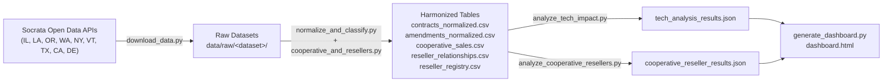
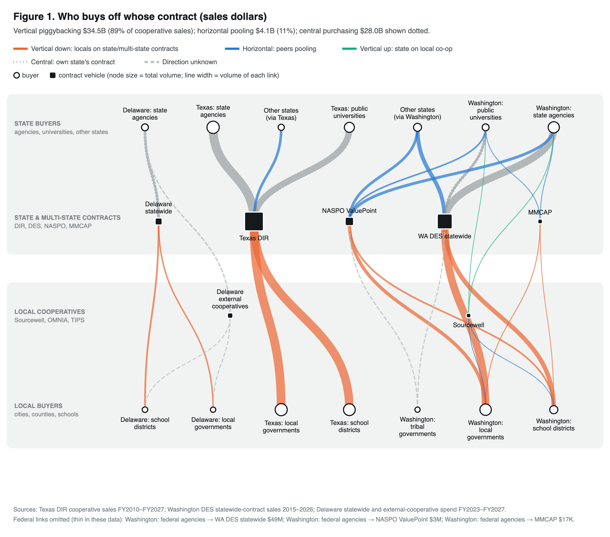
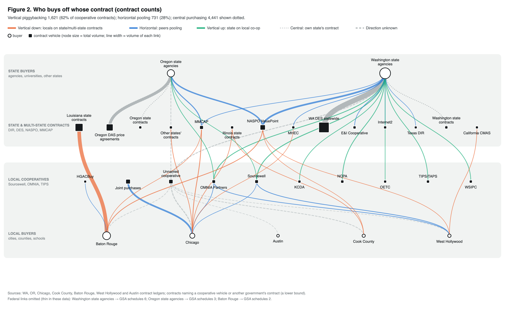
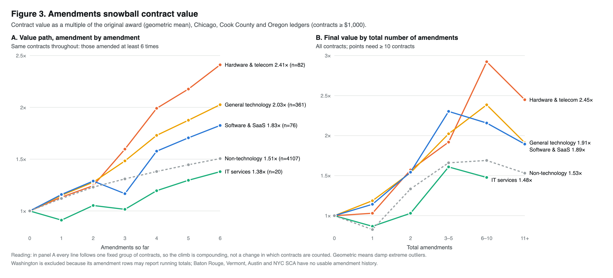
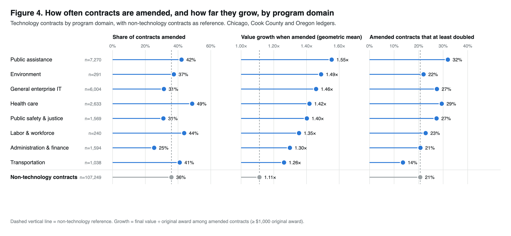
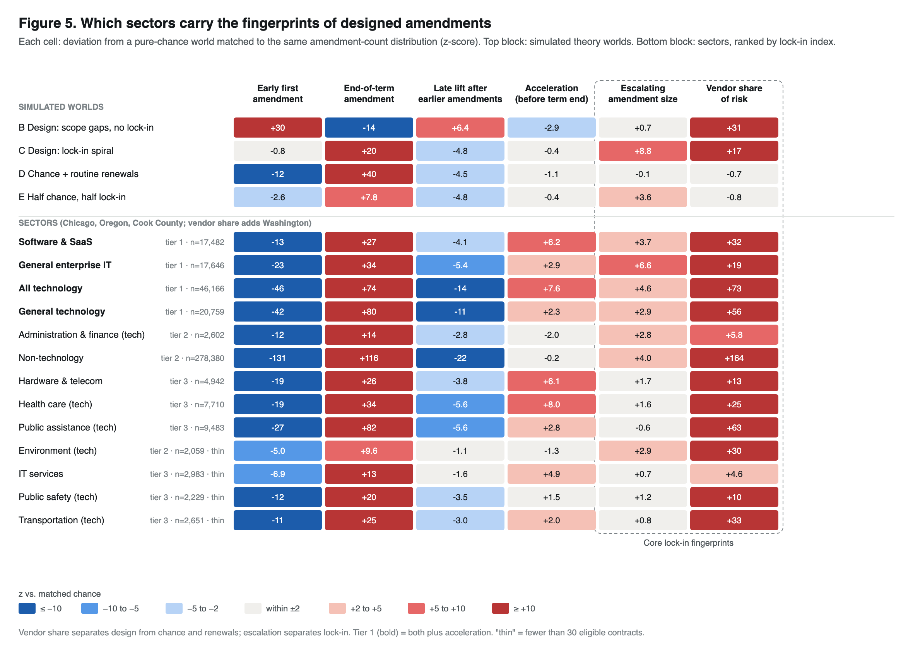

# change_order: Public Contract Amendments & Change Order Analysis

An empirical research toolkit and reproducible data pipeline for analyzing how public procurement contracts change over time—examining amendment frequencies, cost escalation, department concentration, vendor patterns, and the difference between **Technology** and **Non-Technology** contracts across programmatic domains.

---

## 1. Target Data & Jurisdictions

> **Synthesis:** [synthesis/](synthesis/README.md) lays out how theory, simulations and data combine, and the next steps: estimation, validation, and policy counterfactuals.
>
> **Theory:** [game_theory/](game_theory/README.md) models amendments as a vendor strategy and asks why they happen: by chance, or by design (Model 10). Descriptive amendment dynamics come from `scripts/amendment_dynamics.py`.
>
> See **[data.md](data.md)** for the full data structure: source datasets (Table 1), processed files (Table 2), and variable dictionaries (Tables 3–9).

The project targets contract ledgers that capture amendment histories and change orders rather than procurement portals that only list open solicitations:

### A. Contract Ledgers with Amendment Histories (12 jurisdictions in 8 states: state, county, city and authority ledgers)

| Jurisdiction | Level | Dataset | Raw Records | Coverage & Amendment Tracking |
| :--- | :--- | :--- | :--- | :--- |
| **Chicago, IL** | City | [Contracts](https://data.cityofchicago.org/d/rsxa-ify5) | 186,213 | Contract revisions, revised award amounts, de-obligations, and departments. |
| **Baton Rouge, LA** | City-Parish | [Purchase Orders & Contracts](https://data.brla.gov/d/2ung-w7t4) | 345,509 | Municipal & parish purchase orders, adjustments, DBE / minority / veteran flags. |
| **Oregon** | State | [Historical ORPIN Contracts](https://data.oregon.gov/d/6e9e-sfc4) | 93,846 | Amendment sequences, original awards, amendment deltas, and total amended values. |
| **Washington State** | State | Agency Contracts FY[2021](https://data.wa.gov/d/buf8-6px9) · [2022](https://data.wa.gov/d/pwse-3zea) · [2023](https://data.wa.gov/d/mz6y-pfem) · [2024](https://data.wa.gov/d/s8d5-pj78) · [2025](https://data.wa.gov/d/6fx9-ncas) | 379,753 | Amendment identifiers, cost modifications, procurement type (incl. *Statewide Contract*), minority/women-owned, small business, and veteran certification. |
| **Cook County, IL** | County | [Awarded Contracts & Amendments](https://datacatalog.cookcountyil.gov/d/qh8j-6k63) | 8,342 | Extensions, renewals, dollar increases, scope changes. |
| **Oregon Lottery** | State | [Lottery Contracts](https://data.oregon.gov/d/rkhh-35im) | 24,279 | Purchase orders, line-item amendments, and vendor service agreements. |
| **Oregon Judicial Dept.** | State | [Judicial Dept. Contracts](https://data.oregon.gov/d/3wxk-gaen) | 2,829 | Fiscal-year snapshots with original value, running total value, and amendment counts. |
| **Oregon State Treasury** | State | [Treasury Contracts](https://data.oregon.gov/d/4iz8-xm93) | 5,136 | Not-to-exceed amounts with supplemental (amendment) amounts and dates. |
| **New York City** | Authority | [NYC SCA Change Orders](https://data.cityofnewyork.us/d/gzvm-na49) | 11,266 | School construction change orders, workflow stages, and contractor tracking. |
| **Vermont** | State | [Executed Contracts for Service](https://data.vermont.gov/d/dz5q-8uqb) | 6,614 | State agency service contracts, maximum limits, and vendor execution. |
| **West Hollywood, CA** | City | [Active Contracts](https://data.weho.org/d/atdr-sk64) | 1,030 | Original amount vs. current contract total. |
| **Austin, TX** | City | [Contracts](https://datahub.austintexas.gov/d/84ih-p28j) | 625 | Multi-version municipal contracts, authorized limit adjustments. |

### B. Cooperative Purchasing, Resellers & Certification Grades

| Source | Dataset | Records | What it adds |
| :--- | :--- | :--- | :--- |
| **Washington IT Contracts Reports 2020–2025** | [2020](https://data.wa.gov/d/reg9-mjd3) · [2021](https://data.wa.gov/d/bcyw-k8i3) · [2022](https://data.wa.gov/d/dzvi-rs2c) · [2023](https://data.wa.gov/d/hycx-v82h) · [2024](https://data.wa.gov/d/ktim-amuz) · [2025](https://data.wa.gov/d/3txe-z9i9) | 29,967 | Explicit "cooperative purchase?" flag and cooperative name (NASPO ValuePoint, Sourcewell, OMNIA, TIPS, E&I, NCPA, MHEC, GSA, KCDA, WSIPC…) — joined onto WA agency contracts. |
| **Washington DES Statewide (Master) Contract Sales** | [n8q6-4twj](https://data.wa.gov/d/n8q6-4twj) | 245,831 lines → 52,299 aggregated | Spend on state master contracts by customer type (cities, counties, ports, school districts, tribes, other states…) with OMWBE / veteran / small-business status. |
| **Texas DIR Cooperative Contract Sales** | [FY2010–2025 archive](https://data.texas.gov/d/w64c-ndf7) · [FY2026+](https://data.texas.gov/d/a743-wj72) | 13.1M invoice lines → 42,978 aggregated | Sales by customer sector (local government, K-12, higher ed, out-of-state…), **prime vendor vs. authorized reseller**, and the **HUB grade of each** (Woman-owned, Black/Male, Hispanic/Female, Disabled Veteran…). |
| **Texas DIR Active Cooperative Contracts** | [vipt-h4ye](https://data.texas.gov/d/vipt-h4ye) | 5,193 | Prime-vendor → authorized-reseller authorizations per contract. |
| **New York OGS Value-Added Reseller Report** | [cjqa-a3p4](https://data.ny.gov/d/cjqa-a3p4) | 7,770 | Master-contract vendor → value-added reseller (VAR) network. |
| **Delaware Cooperative Spend by Vendor** | [6a9e-y46r](https://data.delaware.gov/d/6a9e-y46r) | 2,102 | Spend through external cooperative contracts by state agencies, school districts, and municipalities. |
| **Delaware Statewide Central Contract Spend** | [sifm-293u](https://data.delaware.gov/d/sifm-293u) | 22,527 | Spend on Delaware statewide contracts by agencies, school districts, and municipalities. |

The 13M-row Texas DIR tables are aggregated server-side (SoQL `$group`) to fiscal year × customer type × contract × prime vendor × reseller × HUB grades.

---

## 2. Pipeline Architecture & Workflow

The analysis runs through reproducible scripts with **zero third-party dependencies** (pure Python standard library, requires Python 3.10+):



---

## 3. Usage Guide

### Step 1: Downloading the Data
Fetches metadata, raw JSON records, and CSV snapshots into `data/raw/<dataset>/`:

```bash
python3 scripts/download_data.py --group primary      # Chicago, Cook County, Oregon, Washington FY2024
python3 scripts/download_data.py --group secondary    # Baton Rouge, Austin, Vermont, Oregon Lottery, NYC SCA
python3 scripts/download_data.py --group expansion    # Washington FY2021-23/FY2025, Oregon Judicial & Treasury, West Hollywood
python3 scripts/download_data.py --group cooperative  # WA IT/master-contract, Texas DIR, NY VAR, Delaware cooperative data
python3 scripts/download_data.py --group federal_schedules  # GSA MAS + VA schedule holders (USASpending): extra reseller evidence + qualification covariates
# or everything at once:
python3 scripts/download_data.py --group all
```

If your Python build cannot reach the OS certificate store, the downloader falls back to `curl` (certificate verification stays on).

### Step 2: Normalization, Tech Classification & Domain Tagging
Standardizes schemas into contract-level and amendment-level tables, cleans currency/date fields, and classifies contracts into **Tech vs. Non-Tech**, **Tech Subsectors**, **Functional Program Domains**, **Cooperative Vehicle & Direction (horizontal vs. vertical)**, **Award Structure (single vs. multiple award)**, **Vendor Role (prime vs. reseller)**, **Vendor Qualification (contract vehicles held, e.g. GSA MAS)**, and **Certification Grade**:

```bash
python3 scripts/normalize_and_classify.py
```

Outputs generated under `data/processed/`:
- `contracts_normalized.csv`: Contract grain (**447,003 records**) with state, level of government, values, growth %, amendment count, duration, tech tags, and: `procurement_method` (the source's own field), `coop_vehicle`, `coop_direction`, `procurement_channel`, `n_contractors`, `award_structure`, `vendor_role`, `qualification_tier`, `gsa_mas_holder`, `n_vehicles_held`, `fss_holder_role`, `vendor_certification`, `amendment_observable`, `n_line_items`.
- `amendments_normalized.csv`: Amendment grain (**231,178 records**).
- `cooperative_sales.csv`: Cooperative / master-contract spend (**119,906 rows**) by program, vehicle, buyer level, `coop_direction`, prime vendor, reseller, and the certification grade of each.
- `award_structure.csv`: One row per cooperative or federal-schedule contract (Texas DIR, NY OGS, WA DES, Delaware, GSA MAS, VA FSS) with solicitation, number of primes awarded under it, number of resellers, and (schedules) holder NAICS role.
- `vendor_qualifications.csv`: One row per vendor with the contract vehicles it holds (GSA MAS, VA FSS, Texas DIR prime/reseller, NY OGS master/VAR, WA DES master, Delaware) and a qualification tier — used as covariates.
- `reseller_relationships.csv`: Prime vendor → authorized reseller pairs (**9,775 rows**, Texas DIR + NY OGS).
- `reseller_registry.csv`: Every firm considered as a reseller, its reseller vs. prime counts, evidence sources, and whether it is classified as a reseller.

### Step 3: Tech vs. Non-Tech Analysis & Econometric Regressions
Computes comparative metrics, programmatic domain distributions, top overrun case studies, and runs a logistic regression with fixed effects for every jurisdiction:

```bash
python3 scripts/analyze_tech_impact.py
```

Structured findings are exported to `data/processed/tech_analysis_results.json`.

### Step 3b: Cooperative Purchasing, Award Structure, Reseller & Qualification Analysis
Amendment outcomes by channel (horizontal / vertical / central), cooperative vehicle, award structure, vendor role, vehicle qualification and certification grade; who buys through cooperative contracts and in which direction; Texas DIR direct vs. reseller sales and HUB grades; reseller networks; and logistic models with all of these terms:

```bash
python3 scripts/analyze_cooperative_resellers.py
```

Structured findings are exported to `data/processed/cooperative_reseller_results.json`.

### Step 4: Interactive Visual Dashboard Generation
Generates a standalone, self-contained interactive HTML dashboard with KPI cards, comparative tables, program domain distributions, regression tables, an overrun case-study explorer, and (when Step 3b has run) a cooperative-purchasing / reseller / certification-grade section:

```bash
python3 scripts/generate_dashboard.py
# Open data/processed/dashboard.html in any web browser
```

### Step 5: Network Page and Publication Figures
Builds the interactive horizontal-vs-vertical cooperative purchasing network and the static figures (standard-library SVG; PNG copies are exported with headless Chrome when available):

```bash
python3 scripts/build_procurement_network.py   # data/processed/procurement_network.{json,html}
python3 scripts/amendment_reasons.py           # why amendments happened: stated reasons → chance / design / ambiguous
python3 scripts/amendment_dynamics.py          # descriptive amendment dynamics
python3 simulations/simulate_amendments.py     # theory worlds + sector fingerprints (~15 min) → simulations/results/
python3 scripts/make_figures.py                # figures/fig1–fig5 *.svg + figure_data.json
```

---

## 4. Classification Taxonomies

### A. Tech vs. Non-Tech & Subsectors
Contracts are categorized based on department mission, commodity classification codes, and keyword expressions:
- `software_saas`: Core business software, SaaS, ERP platforms (Oracle, SAP), database licensing, court docket systems (Tyler Technologies).
- `hardware_telecom`: Servers, networking gear (Cisco), cellular, telecommunications, mainframe hardware, value-added reseller purchases (CDW, SHI).
- `it_services`: IT consulting, cybersecurity, systems integration (Accenture, Deloitte, Kyndryl/IBM), staff augmentation.
- `tech_general`: General technology infrastructure, enterprise applications.
- `non_tech`: Heavy civil construction, architectural design, physical commodities, social care, fleet, facilities.

### B. Functional Program Domains (Tech Contracts)
Identifies the substantive public policy area where technology is deployed:
1. **Health Care**: Electronic health records (EHR), hospital management systems, public health surveillance, Medicaid/Medicare systems (e.g. Cerner, Epic, Oregon MMIS).
2. **Public Assistance & Social Services**: SNAP, TANF, child welfare, eligibility determination systems, foster care case management.
3. **Public Safety & Criminal Justice**: Police CAD/RMS, 911 dispatch, jail management, court docket management, emergency response.
4. **Labor & Workforce**: Unemployment insurance (UI) call centers, benefits modernization, workers' compensation platforms, professional licensing.
5. **Environment & Natural Resources**: EPA/DEQ environmental monitoring, forestry/wildlife data management, GIS mapping, water resources.
6. **Transportation & Transit**: Airport automated transit, tolling, traffic signal management, transit fare systems.
7. **Administration & Finance**: Government-wide financial ERP, tax/revenue collection, citywide procurement contracts.
8. **General Enterprise IT**: Centralized data centers, hosting, help desk, enterprise networks.

### C. Cooperative Vehicle and Direction: Horizontal vs. Vertical
`coop_vehicle` comes from the source's own procurement-method field where one exists — Washington IT Contracts reports (explicit cooperative name, joined on agency + contract number), Washington `procurement_type` ("Statewide Contract"), Chicago `procurement_type` (REFERENCE CONTRACT / JOINT PURCHASE), Oregon ORPIN `award_type` ("Price Agreement"), Austin `rpt_dscr` — and otherwise from contract text (e.g. "State of Illinois contract CMS…", "State Contract 4400…", "Sourcewell contract #…", "OMNIA Partners contract #…").

Each vehicle has the level of government that **established** it:

| Vehicle level | Vehicles |
| :--- | :--- |
| federal | `gsa_federal` (GSA MAS / Cooperative Purchasing / 1122) |
| multi-state | `naspo_valuepoint` (incl. WSCA), `mhec`, `mmcap` |
| state | `texas_dir`, `state_master_contract` (WA DES, Oregon DAS price agreements, DE GSS), `state_contract` (a named state's contract), `calif_cmas` |
| higher-ed consortium | `e_and_i`, `internet2` |
| local-government consortium | `sourcewell`, `omnia_partners` (U.S. Communities / National IPA), `tips_taps`, `ncpa`, `buyboard`, `hgacbuy`, `kcda`, `wsipc`, `oetc`, `peppm`, `local_joint_purchase` |

`coop_direction` compares that level with the **buyer's** level:
- **`horizontal`** — peers pooling demand: states through NASPO ValuePoint/MHEC; cities, counties and schools through Sourcewell, OMNIA, TIPS, BuyBoard or a joint purchase; one state's agencies (or locals) using another state's vehicle (e.g. out-of-state buyers on Texas DIR).
- **`vertical_downward`** — a lower level piggybacks on a higher level's contract: cities, counties and school districts on Texas DIR / WA DES / Delaware / "state contract"; states or locals on GSA schedules; locals on NASPO ValuePoint through a state participating addendum.
- **`vertical_upward`** — a higher level buys through a lower-level consortium (e.g. a Washington state agency using Sourcewell or OMNIA).
- **`central`** — a state agency on its **own** state's master contract. This is centralized purchasing, not cooperative purchasing, and is reported separately.
- **`unknown`** — the vehicle is cooperative but its level is unknown (e.g. "reference contract", "piggyback" without a named vehicle).

`procurement_channel` = `cooperative_<direction>`, `central_state_contract`, or `direct_or_unknown`.

### D. Award Structure: Single vs. Multiple Award, Prime-Direct vs. Reseller
- **Contract ledgers** (`award_structure` in `contracts_normalized.csv`): `n_contractors` = distinct contractors on the **original award** of a contract ID (lowest version only, so vendor renames on later revisions don't count). `single_award_*` = one contractor, `multiple_award_*` = several co-awardees on the same contract; the suffix (`prime_direct` / `reseller`) is the role of the listed vendor.
- **Cooperative vehicles and federal schedules** (`award_structure.csv`): `multiple_award` = ≥ 2 primes under the same solicitation — a Texas DIR RFO, an NY OGS lot, a WA DES or Delaware statewide contract number, a federal schedule (GSA MAS and VA FSS are multiple-award by design). Then `_with_resellers` (≥ 1 authorized reseller sells under the contract), `_prime_direct` (none), `_prime_direct_or_unknown` (the source doesn't report resellers), or `_dealer_holder` (the schedule holder itself is a dealer — wholesale/retail NAICS).

### E. Vendor Role: Prime/Direct vs. Authorized Reseller
A vendor is `authorized_reseller` if any of these hold (after name normalization: case, punctuation, DBA clauses, corporate suffixes):
1. **Observed reselling** another firm's contract — Texas DIR reseller fields, NY OGS VAR report — on ≥ 2 distinct contract/prime pairs **and** on more pairs than the contracts it holds as prime;
2. **Federal schedule dealer** — its GSA MAS / VA FSS contracts are mostly under wholesale or retail NAICS (42xxxx, 44–45xxxx). This reaches regional resellers nationwide that never appear in Texas or New York data;
3. A **curated national VAR** (CDW-G, SHI, Carahsoft, Insight, Presidio, DLT, SoftwareOne…).

Manufacturers (Dell, HP, Cisco, Microsoft, Ricoh, Canon…) are always `prime_or_direct`.

### F. Vendor Qualification: Contract Vehicles Held (covariates)
"Qualification" means which **pre-qualified contract vehicles** a firm holds — like a GSA Multiple Award Schedule contract — and in what role. These are vendor-level covariates, not outcomes. `vendor_qualifications.csv` flags `gsa_mas_holder`, `va_fss_holder`, `texas_dir_prime`, `texas_dir_reseller`, `ny_ogs_master_holder`, `ny_ogs_var`, `wa_des_master_holder`, `delaware_contract_holder`, the schedule holder's NAICS role (`manufacturer` / `dealer_reseller` / `service_provider`), and a tier:
- `federal_schedule_holder` — holds a GSA MAS or VA FSS contract;
- `state_vehicle_prime` — prime on a state cooperative / master vehicle (Texas DIR, NY OGS, WA DES, Delaware) but no federal schedule;
- `authorized_reseller_only` — only authorized to resell under someone else's vehicle;
- `none_observed`.

The federal schedule data is **not required** to identify resellers (§4E rules 1 and 3 work without it); it adds regional dealers as extra evidence and supplies the `gsa_mas_holder` covariate.

### G. Certification Grades
HUB (Texas), OMWBE (Washington), DBE / minority / veteran flags (Baton Rouge) and small-business flags are harmonized into one ordered grade:
`minority_or_women_owned` → `disadvantaged_business` → `veteran_owned` → `small_business` → `not_certified`, with `not_reported` where a source has no such field. In Texas DIR sales the **prime vendor and the reseller each carry their own grade**.

---

## 5. Key Empirical Findings

> Figures below are from the 12-jurisdiction run (447,003 contracts). Washington State now pools FY2021–FY2025 and keys contracts by **agency + contract number** (contract numbers such as `K1234` are reused across agencies, which previously merged unrelated contracts), so Washington figures differ from earlier versions.

### A. Tech Amendment Risk
- **Higher modification rate in most ledgers** (tech vs. non-tech): Washington State **23.5%** vs. **15.6%** (+51% relative risk); Cook County **41.5%** vs. **24.6%** (+69%); West Hollywood **35.7%** vs. **26.8%** (+33%); Oregon Lottery **34.3%** vs. **31.8%**. Chicago, Oregon ORPIN, Oregon Judicial and Oregon Treasury show no tech premium in raw rates.
- Pooled raw rates are not comparable across ledgers (Baton Rouge and NYC SCA are 100% "amended" by construction; see Limitations), which is why the regression below uses jurisdiction fixed effects.

### B. Econometric Model Results (Logistic Regression)
Estimating amendment probability controlling for initial contract scale, contract duration, and jurisdiction fixed effects (reference: Washington State) across **43,405 sampled contracts** from the 10 jurisdictions with outcome variation:

$$\operatorname{logit}\bigl(\mathbb{P}(\text{is\_amended} = 1)\bigr) = \beta_0 + \beta_1 \mathbb{I}_{\text{Tech}} + \beta_2 \log_{10}(\text{Award}) + \beta_3 \log_{10}(\text{Duration}) + \sum_{k} \gamma_k \mathbb{I}_{\text{Jurisdiction}_k}$$

| Variable | Coef ($\beta$) | SE | z-stat | p-value | Odds Ratio | 95% Confidence Interval |
| :--- | :--- | :--- | :--- | :--- | :--- | :--- |
| **`is_tech`** | **+0.2841** | **0.0329** | **+8.64** | **< 0.001** | **1.3286** | **[1.25, 1.42]** |
| $\log_{10}(\text{Award})$ | +0.5831 | 0.0118 | +49.54 | < 0.001 | 1.7916 | [1.75, 1.83] |
| $\log_{10}(\text{Duration})$ | +0.1832 | 0.0127 | +14.43 | < 0.001 | 1.2010 | [1.17, 1.23] |

> Holding award value, duration, and jurisdiction constant, **technology contracts have 32.9% higher odds of amendment** ($\text{OR} = 1.33, z = 8.64, p < 0.001$) — consistent with the earlier 4-jurisdiction estimate (OR = 1.31).

### C. Programmatic Domain Variations (Tech Contracts)

| Functional Domain | Total Contracts | Amended | Amendment Rate | Mean Cost Growth on Amended Contracts* |
| :--- | :--- | :--- | :--- | :--- |
| **Public Safety & Justice** | 3,342 | 1,792 | **53.6%** | 154.8% |
| **General Enterprise IT** | 26,789 | 10,802 | **40.3%** | 97.3% |
| **Transportation & Transit** | 2,831 | 1,138 | **40.2%** | 53.7% |
| **Public Assistance & Social Services** | 9,527 | 3,513 | **36.9%** | 123.0% |
| **Health Care** | 7,801 | 2,348 | **30.1%** | 129.5% |
| **Environment & Natural Resources** | 2,140 | 638 | **29.8%** | 4,176.5% |
| **Labor & Workforce** | 1,802 | 448 | **24.9%** | 112.8% |
| **Administration & Finance** | 4,426 | 1,005 | **22.7%** | 165.3% |

\* Means are dominated by a few extreme contracts (medians are ~0%); read them as tail-risk indicators.

### D. Representative Overrun Case Studies by Domain
- **Health Care**: *EDS (Oregon MMIS - Medicaid Management Information System)*: Initial award of \$82.7M expanded by **+\$259.5M** (+313.9%) across 25 revisions.
- **Public Assistance**: *Deloitte Consulting (Oregon DHS Integrated Eligibility System)*: Initial award of \$98.2M expanded by **+\$175.5M** (+178.6%) across 10 amendments.
- **Labor & Workforce**: *Presidio (Oregon Employment Dept UI Call Center Upgrade)*: Initial award of \$2.25M expanded by **+\$6.12M** (+271.7%) across 12 revisions.
- **Environment**: *Mason Bruce & Girard (ODOT Environmental Analysis & GIS Mapping)*: Initial award of \$300k expanded by **+\$25.3M** (+8,433%) across 3 amendments.
- **Administration / Reseller**: *CDW Government LLC (Chicago)*: Initial award of \$12.0M expanded by **+\$494.0M** (+4,109%) across 19 revisions.

### E. Cooperative Purchasing, Resellers & Certification Grades
Run `python3 scripts/analyze_cooperative_resellers.py` for the full tables.

**Who uses cooperative contracts.** Local governments are major buyers on state cooperative vehicles:

| Program | Total sales | State agencies | Local governments | K-12 | Higher ed | Out of state |
| :--- | ---: | ---: | ---: | ---: | ---: | ---: |
| Texas DIR (FY2010–FY2027 YTD) | $41.5B | 28.5% | **27.1%** | 25.5% | 14.4% | 1.5% |
| Washington DES master contracts | $25.4B | 34.7% | **37.6%** | 10.3% | 4.7% | 9.9% |
| Delaware statewide central contracts | $1.31B | 75.3% | 8.3% | 16.5% | – | – |
| Delaware external cooperative contracts | $213M | 65.6% | **21.0%** | 13.4% | – | – |

**Amendment outcomes by channel** (pooled logit with tech, size, duration, and jurisdiction controls; N = 43,405):

| Term | Odds ratio | 95% CI | p |
| :--- | ---: | :--- | ---: |
| `is_cooperative` (NASPO, Sourcewell, OMNIA, TIPS, E&I…) | **1.83** | [1.20, 2.78] | 0.005 |
| `is_statewide_master` | **1.95** | [1.58, 2.40] | < 0.001 |
| `is_reseller` (authorized reseller vs. prime/direct) | 0.86 | [0.71, 1.04] | 0.12 |
| `cert_minority_or_women_owned` (vs. not certified) | **1.54** | [1.15, 2.06] | 0.004 |
| `cert_veteran_owned` | 0.85 | [0.52, 1.40] | 0.53 |
| `cert_small_business` | 0.91 | [0.76, 1.10] | 0.33 |

In the **Washington-only model** (FY2021–FY2025, N = 51,362), where cooperative flags and certifications are recorded most completely, cooperative purchases (OR 1.57), statewide master contracts (OR 1.77), resellers (OR **1.36**, p < 0.001) and minority/women-owned vendors (OR 1.45) are all associated with higher amendment odds. NASPO ValuePoint purchases are amended at 66.2% (n = 402) vs. 29.2% for state master contracts. Contracts placed through cooperative vehicles are typically agency-level orders and renewals against an umbrella award, so "amendment" here partly reflects how these orders are extended and re-funded rather than scope failure.

**Prime vendors vs. resellers in Texas DIR.** 26.4% of DIR sales ($11.0B) flow through an authorized reseller rather than the prime; the reseller share rose from 19% (FY2010) to roughly 29–34% (FY2017–FY2024). Almost all primes on reseller-routed sales are **not** HUB-certified (99.96%), while **27.7%** of reseller-routed dollars go through a HUB-certified reseller. Of the $7.29B in HUB-credited DIR sales (prime *or* reseller is HUB), **$3.04B (41.7%) is a non-HUB prime selling through a HUB reseller** — the reseller tier is how much of the program's HUB participation happens.

**Reseller networks.** Texas DIR primes authorize a median of 11 resellers (Carahsoft: 989 relationships, TD SYNNEX: 264, immix: 194); NY OGS master-contract vendors a median of 7 VARs across 1,581 distinct resellers.

---

## 6. Known Limitations

- **Baton Rouge and NYC SCA are 100% "amended."** Baton Rouge records are purchase-order line items grouped by source document, so any multi-line PO counts as amended; NYC SCA is a change-order-only file. Both are excluded from the regressions (no outcome variation) and from the certification-grade comparison.
- **Washington `cost_of_contract`** is undocumented; the pipeline treats the first row as the original value and the maximum as the final value.
- **Cooperative flags are sparse outside Washington.** Most ledgers don't record the vehicle, so `direct_or_unknown` mixes own solicitations with unflagged cooperative purchases; channel effects are best read from the Washington model.
- **Reseller classification is a name-based heuristic** (see §4D). It recognizes resellers active on Texas DIR / NY OGS contracts or on the curated VAR list; regional resellers elsewhere may be tagged `prime_or_direct`.
- **Texas DIR active-contracts HUB fields** report the same value for prime and reseller on 100% of rows, so prime-vs-reseller grade comparisons use the sales data instead. FY2026+ sales come from DIR's new Vendor Sales Reporting system; the drop in reseller share there may partly be a reporting change.
- **West Hollywood** publishes amendment-count fields that are empty; amendments are inferred from original vs. current totals.

---

## 7. Figures

All figures are in [`figures/`](figures/) as SVG (vector, for papers) and 2× PNG. The numbers behind them are in `figures/figure_data.json`.

**Figure 1–2. Who buys off whose contract.** Four tiers: state buyers, state & multi-state contract vehicles, local cooperatives, local buyers. Short links stay within a level of government (horizontal pooling, or central purchasing on a state's own contract, dotted); long links cross levels (vertical piggybacking). Figure 1 weights links by sales dollars (Texas DIR, Washington DES, Delaware); Figure 2 by contract counts in the ledgers. The federal tier is omitted because it is thin in these data (listed in each figure's footnote).




**Figure 3. Amendments snowball contract value.** Contract value as a multiple of the original award (geometric mean) in ledgers that report each amendment's dollar change (Chicago, Cook County, Oregon ORPIN / Treasury / Judicial). Panel A follows one fixed group of contracts (amended ≥ 6 times) amendment by amendment, so the climb is compounding rather than a change in which contracts are counted: hardware & telecom contracts reach 2.4× their original value after six amendments, general technology 2.0×, software & SaaS 1.8×, non-technology 1.5×. Panel B shows final value by total number of amendments.



**Figure 4. By program domain.** Share of contracts amended, value growth among amended contracts, and the share of amended contracts that at least doubled. Technology contracts in public assistance (1.55×), environment (1.49×) and general enterprise IT (1.46×) grow most when amended, against 1.11× for non-technology contracts.



**Figure 5. Which sectors carry the fingerprints of designed amendments.** Simulated theory worlds (top) and sectors (bottom), each compared with a pure-chance world matched to its own amendment-count distribution. Every sector shows the end-of-term renewal regime. Vendor concentration separates design from chance and renewals; escalating amendment sizes separate lock-in. Software & SaaS and general enterprise IT carry both most strongly. Simulation code, results and figures S1–S3 are in [simulations/](simulations/README.md). See [game_theory/amendments/07_simulated_implications.md](game_theory/amendments/07_simulated_implications.md).


