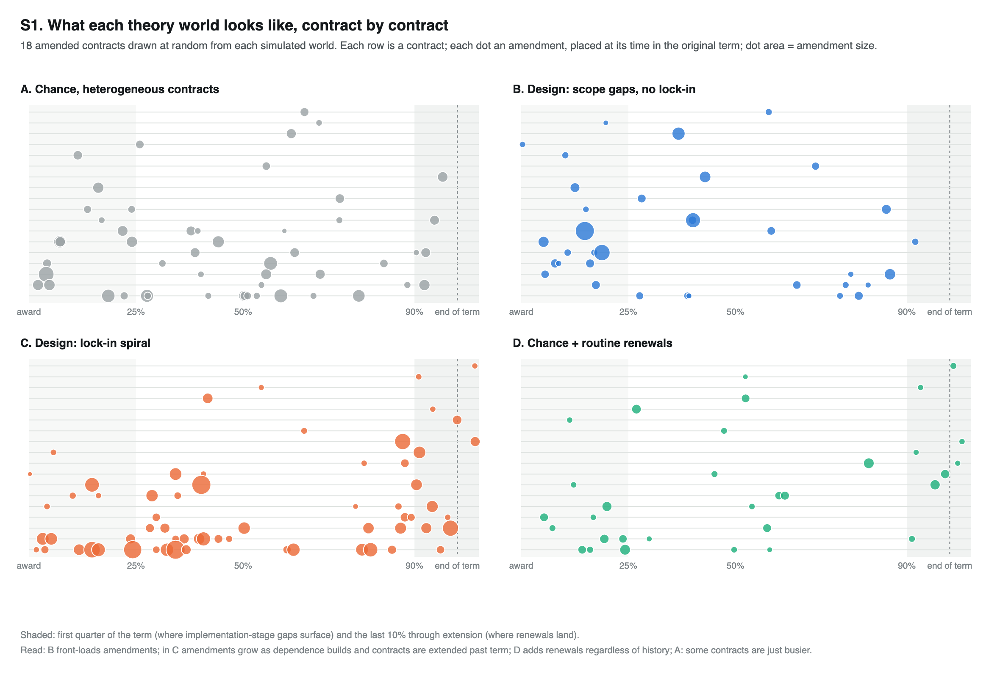
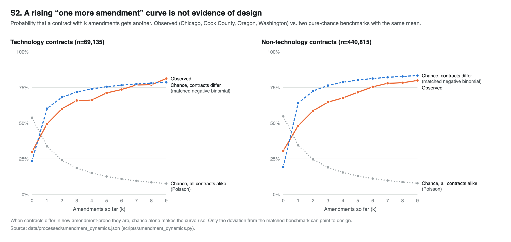
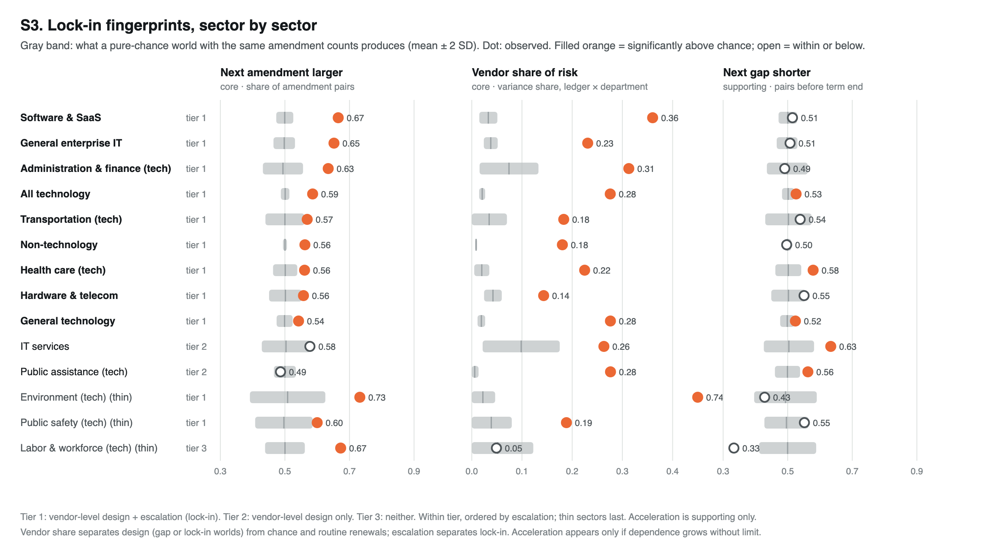

# Simulations: chance versus designed amendments

This folder holds the simulation code and its saved results. The theory is in [game_theory/amendments/04_chance_vs_design.md](../game_theory/amendments/04_chance_vs_design.md) (Model 10), and the full write-up is [game_theory/amendments/07_simulated_implications.md](../game_theory/amendments/07_simulated_implications.md).

The question is whether a sector's amendment histories look like amendments happen **by chance** or **by design** (vendors leaving work to be bought back later under lock-in). Instead of fitting a regression, the simulation turns each theory into a data-generating process. It derives each one's observable implications ("fingerprints"), then checks which sectors carry them. Every comparison is against a pure-chance world matched to the same amendment-count distribution, so "some contracts are simply amendment-prone" is ruled out first.

## Contents

```text
simulations/
├── simulate_amendments.py       theory worlds, sector fingerprints, scoring
├── plot_simulations.py          figures S1–S3
├── results/
│   ├── amendment_fingerprints.json   everything, with definitions
│   ├── theory_worlds.csv             world × fingerprint: observed, chance mean/SD, z
│   ├── sector_fingerprints.csv       sector × fingerprint: observed, chance mean/SD, z
│   ├── sector_similarity.csv         sector: cosine similarity to each world
│   ├── lockin_ranking.csv            sectors by evidence tier
│   └── run_log.txt                   log of the full run that produced the sector results
└── figures/                     S1–S3 as SVG and 2× PNG
```

## Run

From the repository root, after `scripts/normalize_and_classify.py` and `scripts/amendment_reasons.py`:

```bash
python3 simulations/simulate_amendments.py                # full run, ~15 minutes
python3 simulations/simulate_amendments.py --theory-only  # re-simulate theory worlds only (~1 minute)
python3 simulations/simulate_amendments.py --score-only   # re-score saved results, rewrite CSVs
python3 simulations/plot_simulations.py                   # figures S1–S3
python3 scripts/make_figures.py                           # Figure 5 (figures/) reads these results
```

Standard library only. The random seed is fixed (`20261108`), so runs are reproducible.

## The five worlds

| World | Process |
| --- | --- |
| A | Chance; contracts differ in how amendment-prone they are |
| B | Design through scope gaps that surface at implementation |
| C | Design through lock-in: each amendment raises dependence (saturating after ~4), which raises the hazard, the size of later amendments, and the odds of extension instead of re-competition |
| D | Chance plus routine planned renewals |
| E | Half A, half C |

## Figures

**S1. What each world looks like, contract by contract.** Sample contract histories from worlds A–D.



**S2. A rising "one more amendment" curve is not evidence of design.** Chance with heterogeneous contracts already produces it. In the data, the observed curve sits below the matched-chance curve after the first amendment.



**S3. Lock-in fingerprints, sector by sector.** Each sector's observed value against the band its matched chance world produces:
- **Vendor share of risk** separates design from chance and renewals.
- **Escalating amendment size** separates lock-in.
- **Acceleration** is supporting evidence only.



Figure 5 ([figures/fig5_amendment_fingerprints.png](../figures/fig5_amendment_fingerprints.png)) summarizes all fingerprints for the worlds and the sectors in one heatmap.

## Main results

From the 2026-11-08 run (seven ledgers with dated amendments, 269,787 contracts):

- **Pooled, nearly every sector shows the end-of-term renewal regime.** This describes Chicago, Oregon and Cook County. Washington's labelled amendments come early in every sector.
- **Pooled, Software & SaaS and general enterprise IT are most aligned with lock-in.** Their second amendment exceeds the first 15–17 points more often than chance, alongside vendor-level concentration. IT services drops to tier 2 (vendor concentration only).
- **Within ledgers, the software lead shrinks to about +4 points** over non-tech ([robustness_checks.md](../robustness_checks.md), R15). Most of the pooled gap reflects Washington, where escalation is high in every sector.
- **Stated reasons in the ledgers rarely say why** an amendment happened (`scripts/amendment_reasons.py`). The fingerprints carry the inference.

## Limits

- **Illustrative parameters.** The world parameters are not estimated. The next step is simulated method of moments by sector, to estimate a designed share rather than match a pattern.
- **Constant-hazard benchmark.** The matched chance world assumes a constant hazard over the term.
- **Vendor share mixes strategy with specialization.** Cells hold the ledger and department fixed, but vendors within a department can still do different kinds of work.
