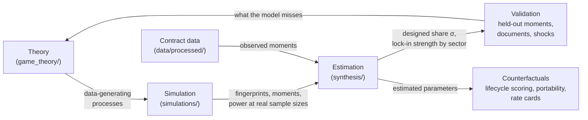

# Synthesis: combining simulations with empirical analysis

This folder is where the three strands of the project meet:

| Strand | Folder | What it gives |
| --- | --- | --- |
| Theory | [game_theory/](../game_theory/README.md) | Mechanisms: lock-in bargaining (Model 1), paid remediation (Model 2), chance vs. design (Model 10) |
| Simulation | [simulations/](../simulations/README.md) | Each mechanism's observable fingerprints, derived rather than assumed |
| Empirical | [scripts/](../scripts/), `data/processed/` | Contract and amendment histories for 12 jurisdictions; cooperative purchasing; resellers; stated reasons |

So far the simulations have been used to *classify* sectors by pattern: which fingerprints a sector carries relative to a matched chance world. The next steps turn that pattern match into *estimates*, *tests* and *counterfactuals*. The detailed plan is in [next_steps.md](next_steps.md).

## The loop

## Roadmap at a glance

| # | Step | Combines | Main output | Status |
| --- | --- | --- | --- | --- |
| 1 | Parameter recovery and power | Simulation at the data's sample sizes | Which sectors can be estimated at all; minimum detectable lock-in | **Done.** Power fine; recovery shows step 2 is not identified |
| 2 | Simulated method of moments by sector | Simulation + fingerprints from the data | Designed share σ and lock-in strength per sector, with intervals | **Run, not usable**: needs lock-in-specific moments |
| 3 | Out-of-sample validation | Estimates + held-out moments and ledgers | Does the fitted model predict what it was not fit to? | Waits on step 2 |
| 4 | Comparative statics across procurement channels | Model 10's φ + cooperative/vertical/central channels | Does design rise where the award weights later costs less? | Waits on step 2 |
| 5 | Vendor-level lock-in | Estimates + resellers, GSA MAS holders, award structure | Is lock-in concentrated in certain vendor types? | Waits on step 2 |
| 6 | Ground truth from documents | 235 OCR'd Chicago amendment documents + coder + manual review | Why amendments happened | **Done** |
| 7 | Chance shocks | Dated event studies (COVID-19, H.R. 1) | Separate estimate of the chance component \(\lambda_0\) | **Dropped**: the ledgers are not good enough to isolate a dated shock |
| 8 | Policy counterfactuals | Estimated parameters + Model 10 levers | Predicted change in amendment spending by lever and sector | Waits on step 2 |

**Results so far: [RESULTS.md](RESULTS.md).**

## Ground rules carried over

- **Match the benchmark to the data.** Every comparison is against a chance world with the same amendment-count distribution. Raw patterns, such as a rising "one more amendment" curve, are not evidence by themselves.
- **Use robust implications only.** Acceleration between amendments appeared only when dependence grows without limit, so it stays a supporting signal.
- **Keep ledgers separate until pooling is justified.** Ledgers record amendments differently; estimate within ledger first.
- **Treat fit as necessary, not sufficient.** A world that fits the moments is consistent with the data. It is not proof of vendor intent.
